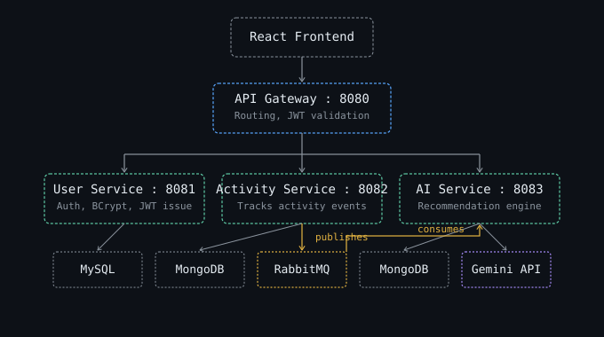
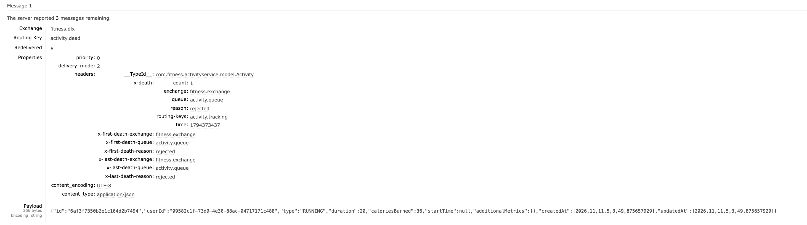

# FitPulse — Event-Driven Fitness Platform

A **microservices-based fitness tracking application** built with Spring Boot, Spring Cloud, React, MongoDB, MySQL, RabbitMQ and Google Gemini.

Users register and log in with JWT authentication, log fitness activities, and receive an AI-generated recommendation for each activity. Activity tracking is decoupled from the AI analysis with RabbitMQ, so saving an activity never waits for Gemini and a Gemini outage never loses data.

---

## 🚀 Features

* JWT authentication with BCrypt password hashing; registration also returns a token, so a new user is logged in immediately
* **Per-user authorization:** users can only read their own activities, recommendations and profile (ownership checks, no role-based access)
* Fitness activity tracking (running, walking, cycling, swimming, weight training, yoga, HIIT, cardio, stretching, other)
* AI-generated recommendations (analysis, improvements, next-workout suggestions, safety tips) from Google Gemini
* Asynchronous processing with RabbitMQ
* API Gateway with centralized JWT validation; the gateway sets the `X-User-ID` header itself and overwrites any client-supplied value
* Service discovery with Eureka and centralized configuration with Spring Cloud Config
* MySQL for users, MongoDB for activities and recommendations
* RabbitMQ listener retries with exponential backoff, then dead-letters failed messages to `activity.dlq`
* **Idempotent AI consumer:** a unique index on `activityId` plus duplicate-key handling means a redelivered or concurrently delivered message never creates a duplicate recommendation
* Request validation and JSON error responses (400 / 401 / 403 / 404 / 503)
* React frontend (Redux Toolkit, Material UI) as a demo client
* One-command backend with Docker Compose, 35 unit tests, and a GitHub Actions CI pipeline

---

## 🏗️ Architecture



### Services and ports

| Component | Port | Role |
| --------- | ---- | ---- |
| API Gateway | `8080` | Routes `/api/**`, validates JWTs, sets `X-User-ID`, CORS |
| User Service | `8081` | Registration, login, JWT issuing, profile (MySQL) |
| Activity Service | `8082` | Stores activities (MongoDB), publishes events to RabbitMQ |
| AI Service | `8083` | Consumes events, calls Gemini, stores recommendations (MongoDB) |
| Eureka Server | `8761` | Service discovery |
| Config Server | `8888` | Centralized configuration (internal only: not published to the host in Docker Compose) |

---

## 🔄 Request Flow

### Authentication

```text
React
  ↓
API Gateway  (register and login are public)
  ↓
User Service
  ↓
MySQL
  ↓
JWT returned to client (userId and email in the response body)
```

The API Gateway validates the JWT on every other request and forwards the authenticated user's ID to downstream services in the `X-User-ID` header.

### Activity + AI processing

```text
React
  ↓
API Gateway
  ↓
Activity Service ──► User Service  (validates the user exists, 5 s timeout)
  ↓
MongoDB  (activity saved)
  ↓
RabbitMQ  (fitness.exchange → activity.queue)
  ↓
AI Service  (consumer)
  ↓
Google Gemini
  ↓
Recommendation → MongoDB
```

Creating an activity returns as soon as it is saved. The recommendation is generated afterwards, so `GET /api/recommendations/activity/{id}` returns `404` until the AI service has finished.

If the User Service is unreachable, creating an activity returns `503`; if the user does not exist, it returns `400`.

---

## 🛠️ Tech Stack

### Backend
* Java 23 (Docker images and CI); Eureka and Config Server are built for Java 17 and run on the same JDK 23 images
* Spring Boot 3.4, Spring Cloud 2024.0
* Spring Cloud Gateway, Eureka, Spring Cloud Config
* Spring Data JPA (MySQL), Spring Data MongoDB
* Spring AMQP (RabbitMQ), WebClient
* JJWT (HMAC-SHA256), BCrypt
* JUnit 5, Mockito

### Frontend
* React 19, Vite, Redux Toolkit, React Router, Axios, Material UI

### Data, messaging and AI
* MySQL 8.4, MongoDB 7, RabbitMQ 3 (management UI)
* Google Gemini API

---

## 📁 Project Structure

```text
FitPulse/
├── eureka/                  service discovery
├── configserver/            centralized configuration (config/*.yml per service)
├── gateway/                 API gateway, JWT filter, CORS
├── userservice/             users and authentication (MySQL)
├── activityservice/         activities and event publishing (MongoDB, RabbitMQ)
├── aiservice/               event consumer, Gemini integration (MongoDB)
├── fitness-app-frontend/    React demo client
├── docs/                    screenshots
├── fitpulse-architecture.svg
├── docker-compose.yml
├── .env.example
└── .github/workflows/ci.yml
```

---

## 🔌 Main APIs

All requests go through the gateway at `http://localhost:8080`.

| Method | Endpoint | Auth | Description |
| ------ | -------- | ---- | ----------- |
| POST | `/api/users/register` | public | Register (email, password of at least 6 characters, optional first and last name); returns `201` with a JWT |
| POST | `/api/users/login` | public | Log in; returns a JWT |
| GET | `/api/users/{id}` | JWT | Get your own profile (`403` for another user's id) |
| GET | `/api/users/{id}/validate` | JWT | Returns whether a user id exists (used internally by the Activity Service) |
| POST | `/api/activities` | JWT | Create an activity (`type` and `duration` > 0 are required) |
| GET | `/api/activities` | JWT | List your activities, newest first |
| GET | `/api/activities/{id}` | JWT | Get one of your activities |
| GET | `/api/recommendations/activity/{id}` | JWT | Get the AI recommendation for one of your activities |
| GET | `/api/recommendations/user/{id}` | JWT | Get all of your recommendations (`403` for another user's id) |

Protected requests need:

```http
Authorization: Bearer <JWT>
```

**Status codes:** `201` registered · `400` validation error, duplicate email, wrong credentials or unknown user · `401` missing, invalid or expired token (from the gateway) · `403` resource belongs to another user · `404` not found, or recommendation not generated yet · `503` a dependency such as the User Service is unavailable.

---

## ⚙️ Getting Started

### Option A — Docker Compose (recommended)

Requires Docker only.

```bash
cp .env.example .env        # then edit JWT_SECRET, DB_PASSWORD, GEMINI_API_URL, GEMINI_API_KEY
openssl rand -base64 48     # one way to generate a strong JWT_SECRET
docker compose up --build
```

Compose refuses to start if `JWT_SECRET` or `DB_PASSWORD` is missing, so no service ever runs with a blank secret. `GEMINI_API_URL` must be the model's `generateContent` URL **without** the key; set it to a Gemini model your API key can use. Without a valid key the platform still runs, but recommendations fail and end up in the dead-letter queue.

This starts MySQL (host port `3307`), MongoDB (`27017`), RabbitMQ (`5672`, management UI on `15672`), Eureka (`8761`), the Config Server (reachable only inside the Docker network), the User, Activity and AI services, and the gateway on `8080`. Services that start before the Config Server is ready exit and are restarted automatically by Docker, so the first start can take a minute.

Then run the frontend:

```bash
cd fitness-app-frontend
npm install
npm run dev      # http://localhost:5173
```

The gateway's CORS configuration allows the frontend origin `http://localhost:5173`, so open the app on that address. The RabbitMQ management UI is at http://localhost:15672 (`guest` / `guest`).

### Option B — Run locally

Prerequisites: JDK 23 or newer, Node.js, MySQL 8, MongoDB, RabbitMQ, a Gemini API key.

Secrets are read from each service's **own** environment, never from the Config Server (which serves its files over HTTP):

| Service | Environment variables |
| ------- | --------------------- |
| `gateway` | `JWT_SECRET` (32+ characters) |
| `userservice` | `JWT_SECRET` (same value), `SPRING_DATASOURCE_PASSWORD` |
| `aiservice` | `GEMINI_API_URL` (without the key), `GEMINI_API_KEY` |
| `configserver` | none required for the defaults (optional overrides: `DB_URL`, `DB_USERNAME`, `RABBITMQ_HOST`, `EUREKA_URL`, `ACTIVITY_MONGO_URI`, `AI_MONGO_URI`) |

Start in this order (each with `./mvnw spring-boot:run`): Eureka → Config Server → User / Activity / AI services → API Gateway → frontend.

> The Config Server import is mandatory, so start it before the other services.

---

## 🧪 Tests

```bash
cd gateway && ./mvnw test
cd userservice && ./mvnw test
cd activityservice && ./mvnw test
cd aiservice && ./mvnw test
```

**35 unit tests** (JUnit 5 + Mockito) across the four services:

* **Gateway (10):** missing, malformed, expired and wrongly-signed tokens are rejected with 401; a valid token forwards `X-User-ID`; a spoofed `X-User-ID` header is overwritten; register and login are public; CORS preflight requests pass through without a token while a plain `OPTIONS` request is still rejected; the CORS filter is guaranteed to run before the JWT filter
* **User service (7):** registration hashes the password with BCrypt, duplicate emails are rejected, login succeeds and fails correctly, the profile never exposes the password
* **Activity service (7):** saves and publishes the event, rejects an invalid user without saving, still saves the activity when the broker is down, enforces ownership
* **AI service (11):** Gemini response parsing with fallback on malformed or empty output, idempotent message listener (including a concurrent duplicate insert), failures propagate so RabbitMQ retries and dead-letters, ownership checks on recommendations

Eureka and the Config Server only have a context-load test, and the tests do not run against real databases or a real broker yet.

CI (GitHub Actions) runs the four services' tests and builds the frontend on every push to `main` and on every pull request.

---

## 🛡️ Reliability & Security Notes

* **Authorization:** the gateway validates the JWT and sets `X-User-ID` itself (a client-supplied value is overwritten). Downstream services compare it to the owner of the requested resource and return `403` otherwise.
* **Failed AI jobs:** the AI listener makes up to 3 delivery attempts, with a 2 s and then a 4 s pause between them (exponential backoff). A message that still fails is rejected without requeue and routed through `fitness.dlx` to the dead-letter queue `activity.dlq` for inspection.
* **Malformed Gemini output:** if Gemini answers but the response cannot be parsed, a safe default recommendation is stored instead of failing the message. Network errors, timeouts and HTTP errors from Gemini (for example an exhausted quota) are what trigger the retry and dead-letter path.
* **Gemini:** calls time out after 30 seconds, and the API key is sent in the `x-goog-api-key` header instead of the URL.
* **Secrets:** all secrets come from environment variables; `.env` is git-ignored. Each service receives only the secrets it needs, and none are passed to the Config Server.

### Known limitations

* If RabbitMQ is down at the moment an activity is created, the activity is saved but no event is published, so it will not get an AI recommendation. A transactional outbox would fix this.
* Services trust the gateway's `X-User-ID` header, so they must not be exposed publicly (in Docker Compose only the gateway and infrastructure ports are meant to be used).
* RabbitMQ uses the default `guest` account, which is fine for local development only.
* The Config Server has no authentication. Docker Compose keeps it off the host network; a real deployment would put it behind authentication (and use encrypted properties for anything sensitive).
* JWTs expire after 24 hours; there is no refresh-token flow or revocation, and the frontend keeps the token in `localStorage`.
* The application services expose no health or metrics endpoints yet (no Spring Boot Actuator), and `GET /api/activities` is not paginated.
* The frontend is a minimal demo client and is not containerized. There are no integration tests against real databases yet.

---

## 🎬 Failure handling demo

When the Gemini call fails (here: API quota exhausted), the activity is still saved, the AI
message is retried with backoff, and then dead-lettered to `activity.dlq` instead of being lost.
The `x-death` header records where it failed (`activity.queue`, reason `rejected`):



---

## 👩‍💻 Author

**Madhuri H S** · [LinkedIn](https://www.linkedin.com/in/madhuri-h-s/) · [GitHub](https://github.com/MADHURI-HS)
