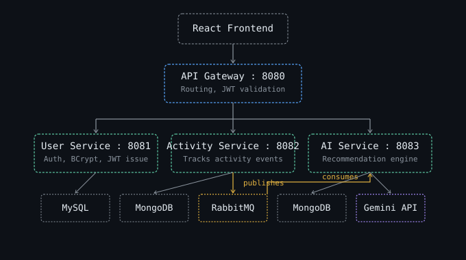
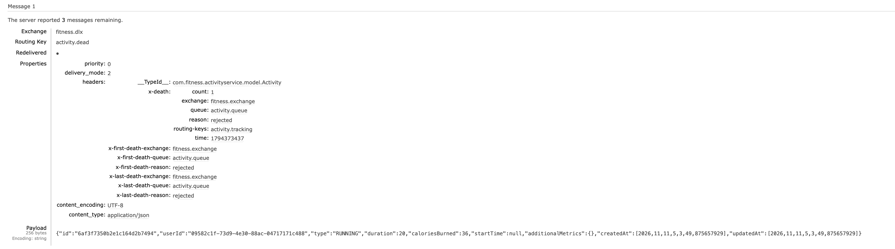

# FitPulse — Event-Driven Fitness Platform

A **microservices-based fitness tracking application** built with Spring Boot, Spring Cloud, React, MongoDB, MySQL, RabbitMQ, and Google Gemini AI.

The application provides JWT-based authentication, fitness activity tracking, and AI-powered fitness recommendations using an event-driven architecture.

---

## 🚀 Features

* JWT-based user authentication and authorization
* User registration and login with BCrypt password hashing
* Fitness activity creation and tracking
* AI-generated fitness recommendations
* Asynchronous activity processing using RabbitMQ
* API Gateway with centralized JWT validation
* Service discovery using Eureka
* Centralized configuration using Spring Cloud Config
* MySQL for user data
* MongoDB for activities and recommendations
* React frontend with Redux Toolkit
* Per-user authorization: users can only read their own activities, recommendations and profile
* RabbitMQ listener retries with exponential backoff, then dead-letters failed messages to `activity.dlq`
* Idempotent AI consumer (a unique index on `activityId` plus duplicate-key handling means a redelivered or concurrently delivered message never creates a duplicate recommendation)
* Request validation and JSON error responses (400 / 403 / 404 / 503)
* One-command run with Docker Compose, plus unit tests and a GitHub Actions CI pipeline

---

## 🏗️ Architecture



### Infrastructure

* **Eureka Server** — service discovery (`:8761`)
* **Config Server** — centralized configuration (`:8888`, internal only: not published to the host in Docker Compose)
* **API Gateway** — routing and JWT validation (`:8080`)

---

## 🔄 Request Flow

### Authentication

```text
React
  ↓
API Gateway
  ↓
User Service
  ↓
MySQL
  ↓
JWT returned to client
```

The API Gateway validates the JWT on protected requests and forwards the authenticated user's ID to downstream services through the `X-User-ID` header.

### Activity + AI Processing

```text
React
  ↓
API Gateway
  ↓
Activity Service
  ↓
MongoDB
  ↓
RabbitMQ
  ↓
AI Service
  ↓
Google Gemini
  ↓
Recommendation → MongoDB
```

AI processing is asynchronous, so creating an activity does not have to wait for Gemini to generate the recommendation.

---

## 🛠️ Tech Stack

### Backend

* Java 23
* Spring Boot
* Spring Cloud
* Spring Cloud Gateway
* Eureka
* Spring Cloud Config
* Spring Data JPA
* Spring Data MongoDB
* WebClient
* RabbitMQ
* JWT / JJWT
* BCrypt

### Frontend

* React
* Vite
* Redux Toolkit
* React Router
* Axios
* Material UI

### Databases & AI

* MySQL
* MongoDB
* RabbitMQ
* Google Gemini API

---

## 📁 Project Structure

```text
FitPulse/
├── eureka/
├── configserver/
├── gateway/
├── userservice/
├── activityservice/
├── aiservice/
├── fitness-app-frontend/
├── docs/
├── docker-compose.yml
├── .env.example
├── .github/workflows/ci.yml
└── README.md
```

---

## 🔌 Main APIs

| Method | Endpoint                             | Description           |
| ------ | ------------------------------------ | --------------------- |
| POST   | `/api/users/register`                | Register user         |
| POST   | `/api/users/login`                   | Login                 |
| GET    | `/api/users/{id}`                    | Get user              |
| POST   | `/api/activities`                    | Create activity       |
| GET    | `/api/activities`                    | Get user activities   |
| GET    | `/api/activities/{id}`               | Get activity          |
| GET    | `/api/recommendations/activity/{id}` | Get AI recommendation for an activity |
| GET    | `/api/recommendations/user/{id}`     | Get all of a user's recommendations |

All protected APIs are accessed through the API Gateway using:

```http
Authorization: Bearer <JWT>
```

---

## ⚙️ Getting Started

### Option A — Docker Compose (recommended)

Requires Docker only.

```bash
cp .env.example .env        # then edit JWT_SECRET, DB_PASSWORD, GEMINI_API_URL, GEMINI_API_KEY
openssl rand -base64 48     # one way to generate a strong JWT_SECRET
docker compose up --build
```

Compose refuses to start if `JWT_SECRET` or `DB_PASSWORD` is missing, so no service ever runs with a blank secret.

This starts MySQL (host port `3307`), MongoDB, RabbitMQ (management UI on `:15672`), Eureka, the Config Server (reachable only inside the Docker network), the three services and the gateway on `:8080`. Services that start before the Config Server is ready exit and are restarted automatically by Docker.

Then run the frontend:

```bash
cd fitness-app-frontend
npm install
npm run dev      # http://localhost:5173
```

The gateway's CORS configuration allows the frontend origin `http://localhost:5173`, so open the app on that address. The RabbitMQ management UI is at http://localhost:15672 (`guest` / `guest`).

### Option B — Run locally

Prerequisites: JDK 23 or newer, Node.js, MySQL 8, MongoDB, RabbitMQ, a Gemini API key.

Secrets are read from each service's **own** environment, never from the Config Server (which serves its files over HTTP):

| Service | Environment variables |
| ------- | --------------------- |
| `gateway` | `JWT_SECRET` (32+ chars) |
| `userservice` | `JWT_SECRET` (same value), `SPRING_DATASOURCE_PASSWORD` |
| `aiservice` | `GEMINI_API_URL` (without the key), `GEMINI_API_KEY` |
| `configserver` | none required for the defaults (optional overrides: `DB_URL`, `DB_USERNAME`, `RABBITMQ_HOST`, `EUREKA_URL`, `ACTIVITY_MONGO_URI`, `AI_MONGO_URI`) |

Start in this order (each with `./mvnw spring-boot:run`): Eureka → Config Server → User / Activity / AI services → API Gateway → frontend.

> The Config Server import is mandatory, so start it before the other services.

---

## 🧪 Tests

```bash
cd gateway && ./mvnw test
cd userservice && ./mvnw test
cd activityservice && ./mvnw test
cd aiservice && ./mvnw test
```

Unit tests (JUnit 5 + Mockito) cover:

* Gateway JWT filter — missing, malformed, expired and wrongly-signed tokens are rejected with 401; a valid token forwards `X-User-ID`; a spoofed `X-User-ID` header is overwritten; CORS preflight requests pass through without a token (and the CORS filter is guaranteed to run before the JWT filter)
* User service — registration hashes the password with BCrypt, duplicate emails are rejected, login succeeds/fails correctly
* Activity service — validates the user, saves and publishes the event, survives a broker outage, enforces ownership
* AI service — Gemini response parsing with fallback on malformed output, idempotent message listener (including a concurrent duplicate insert), failures propagate so RabbitMQ retries and dead-letters, ownership checks on recommendations

CI (GitHub Actions) runs these tests and builds the frontend on every push and pull request.

---

## 🛡️ Reliability & Security Notes

* **Authorization:** the gateway validates the JWT and sets `X-User-ID` itself (a client-supplied value is overwritten). Downstream services compare it to the owner of the requested resource and return `403` otherwise.
* **Failed AI jobs:** the AI listener retries 3 times (2s, 4s backoff). Messages that still fail are routed to the dead-letter queue `activity.dlq` for inspection.
* **Gemini:** calls time out after 30 seconds, and the API key is sent in the `x-goog-api-key` header instead of the URL.
* **Secrets:** all secrets come from environment variables; `.env` is git-ignored. Each service receives only the secrets it needs, and none are passed to the Config Server.

### Known limitations

* If RabbitMQ is down at the moment an activity is created, the activity is saved but no event is published, so it will not get an AI recommendation. A transactional outbox would fix this.
* Services trust the gateway's `X-User-ID` header, so they must not be exposed publicly (in Docker Compose only the gateway and infrastructure ports are meant to be used).
* RabbitMQ uses the default `guest` account, which is fine for local development only.
* The Config Server has no authentication. Docker Compose keeps it off the host network; a real deployment would put it behind authentication (and use encrypted properties for anything sensitive).
* JWTs expire after 24 hours; there is no refresh-token flow or revocation, and the frontend keeps the token in `localStorage`.
* The application services expose no health or metrics endpoints yet (no Spring Boot Actuator), and `GET /api/activities` is not paginated.
* The frontend is not containerized, and there are no integration tests against real databases yet.

---

## 🎬 Failure handling demo

When the Gemini call fails (here: API quota exhausted), the activity is still saved, the AI
message is retried with backoff, and then dead-lettered to `activity.dlq` instead of being lost.
The `x-death` header records where it failed (`activity.queue`, reason `rejected`):


